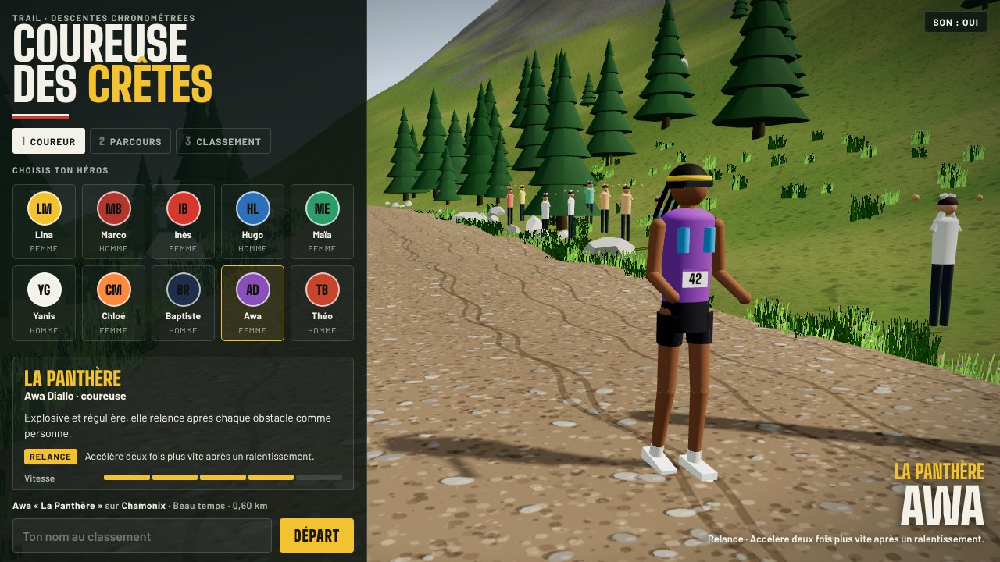
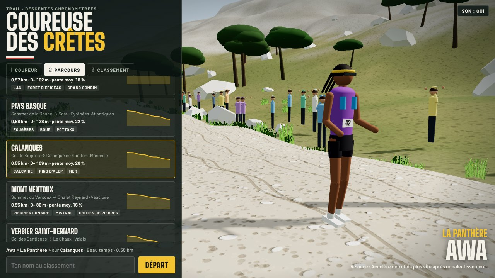
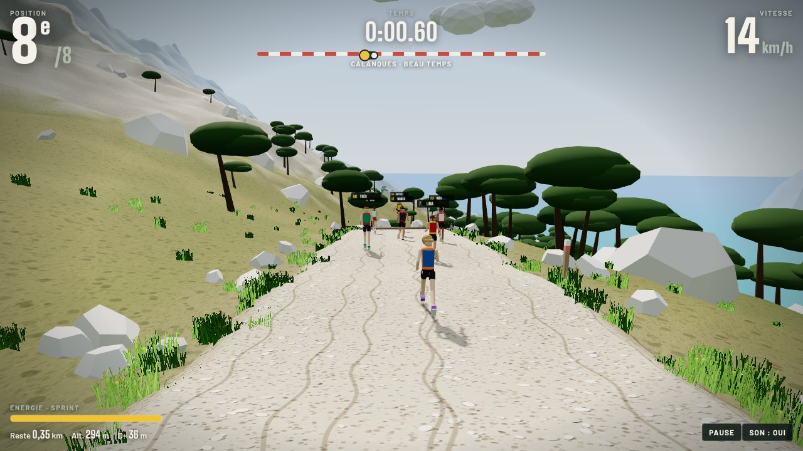
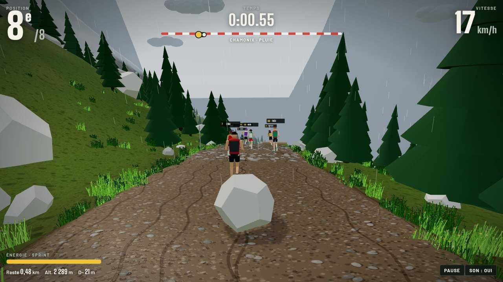
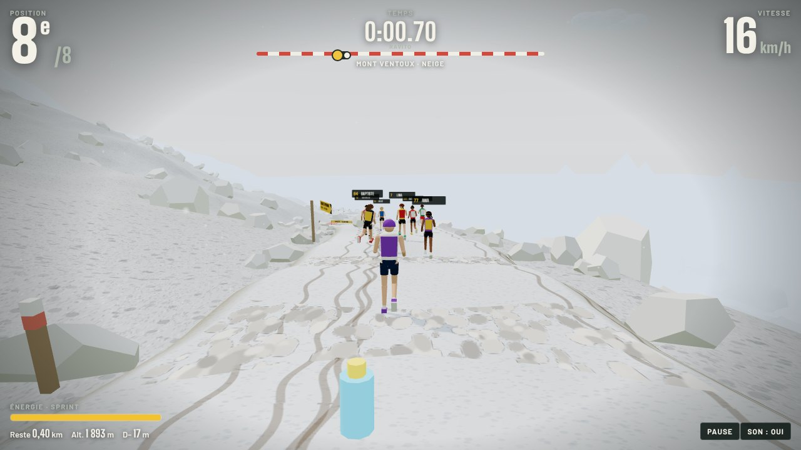
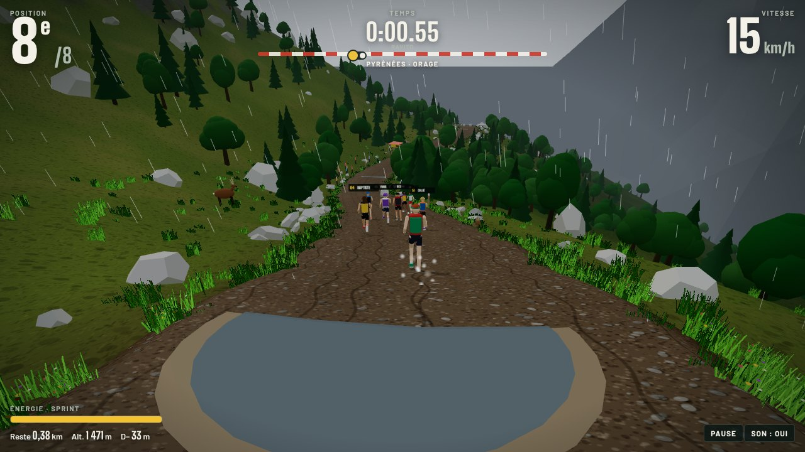
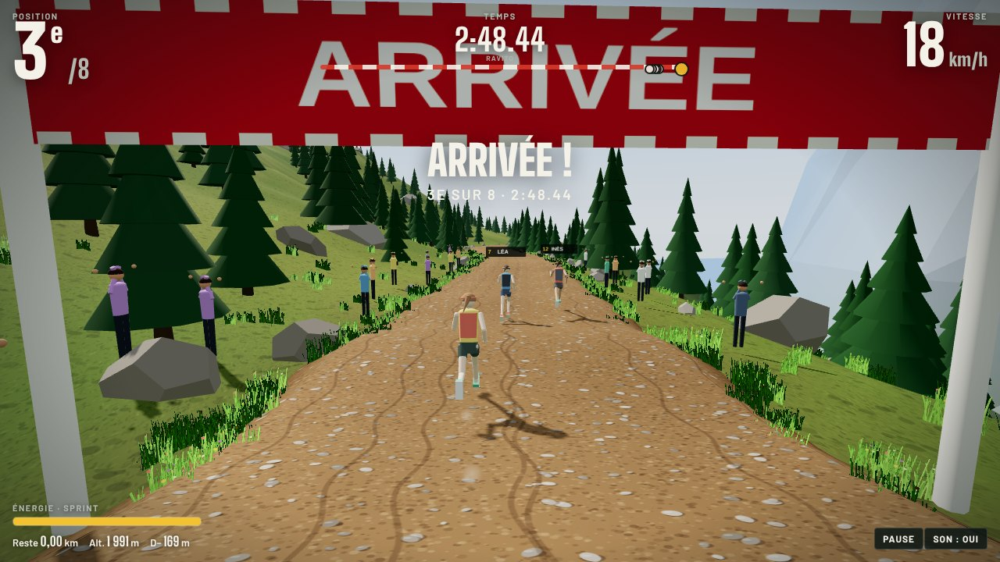

<div align="center">

# 🏔️ Traileurs des Crêtes

**Un jeu 3D de descente en trail, dans le navigateur.**
Choisis ton héros, ton parcours et ta météo, puis dévale le sentier en 2 minutes face à sept rivaux, au milieu de la faune et des pièges de la montagne.




</div>

---

## 🏃 10 héros, 10 caractères

Chaque héros a cinq caractéristiques (vitesse, agilité, saut, endurance, robustesse) qui changent sa façon de courir, et un **talent** qui lui est propre. Le maillot et les chaussures se personnalisent.

| Héros | Surnom | Talent |
|---|---|---|
| Lina Moreau | La Chamois | **Pied sûr** : ne glisse ni dans les pierriers ni sur le verglas |
| Marco Bianchi | Le Bûcheron | **Tronc d’acier** : ne trébuche jamais sur les racines, se relève vite |
| Inès Benali | La Fusée | **Turbo** : sprint nettement plus puissant |
| Hugo Lefèvre | Le Métronome | **Diesel** : le sprint consomme 40 % d’énergie en moins |
| Maïa Etxeberria | La Basque | **Reine de la boue** : la boue et les flaques ne la ralentissent presque pas |
| Yanis Garnier | Le Yéti | **Crampons** : garde toute son adhérence sous la pluie et dans la neige |
| Chloé Martin | L’Écureuil | **Ressort** : saute plus haut et plus loin |
| Baptiste Roux | Le Kamikaze | **Tout schuss** : encore plus rapide dans les pentes raides, mais chutes plus longues |
| Awa Diallo | La Panthère | **Relance** : accélère deux fois plus vite après un ralentissement |
| Théo Blanc | Le Renard | **Flair** : voit venir les dangers deux fois plus tôt, plus d’énergie aux ravitos |

Les sept rivaux de chaque course sont tirés parmi les autres héros, avec leurs propres talents.

---

## 🗺️ 9 parcours d’environ 2 minutes



| Parcours | Descente | Distance | D− | Pente moy. | Particularités |
|---|---|---:|---:|---:|---|
| **Chamonix** | Plan de l’Aiguille → Chalet du Grépon | 600 m | 152 m | 25 % | haute montagne, chutes de pierres, bouquetins |
| **Jura** | Crêt de la Neige → Lélex | 500 m | 59 m | 12 % | forêt, racines, boue, sangliers, chamois |
| **Pyrénées** | Lac d’Oô → Granges d’Astau | 560 m | 113 m | 20 % | lacets, isards, marmottes |
| **Auvergne** | Puy de Dôme → Col de Ceyssat | 630 m | 157 m | 25 % | pouzzolane rouge, volcans, vaches Salers |
| **Champex** | Champex-Lac → Orsières | 570 m | 102 m | 18 % | lac, forêt d’épicéas, Grand Combin |
| **Pays basque** | La Rhune → Sare | 580 m | 128 m | 22 % | fougères, boue, pottoks |
| **Calanques** | Col de Sugiton → Calanque de Sugiton | 550 m | 109 m | 20 % | calcaire blanc, pins d’Alep, mer, chèvres |
| **Mont Ventoux** | Sommet → Chalet Reynard | 550 m | 86 m | 16 % | pierrier lunaire, **rafales de mistral** |
| **Verbier Saint-Bernard** | Col des Gentianes → La Chaux | 590 m | 133 m | 23 % | glacier, neige, marmottes |

La longueur de chaque parcours est calculée à partir de son profil, pour qu’une descente dure environ 2 minutes : plus la pente est douce, plus le parcours est court.

<table>
<tr>
<td width="50%"></td>
<td width="50%"></td>
</tr>
<tr>
<td><b>Calanques</b> · beau temps</td>
<td><b>Chamonix</b> · pluie</td>
</tr>
</table>

---

## ⛈️ La météo change la course

<table>
<tr>
<td width="50%"></td>
<td width="50%"></td>
</tr>
<tr>
<td><b>Mont Ventoux</b> · neige</td>
<td><b>Pyrénées</b> · orage</td>
</tr>
</table>

| Météo | Effets |
|---|---|
| ☀️ **Beau temps** | sol sec, bonne adhérence, visibilité maximale |
| 🌧️ **Pluie** | sentier glissant, moins d’adhérence en virage, la boue et les flaques freinent davantage |
| ❄️ **Neige** | sol blanc, flaques gelées en plaques de verglas, adhérence faible, visibilité réduite |
| ⚡ **Orage** | averse, éclairs, tonnerre, flashs aveuglants, sentier détrempé |

L’option **Météo du jour** tire la météo selon le climat de chaque parcours. Elle est la même pour tout le monde le même jour.

---

## ⚠️ Les dangers

- 🦌 **Animaux qui traversent** : cerfs ou sangliers, qui surgissent quand tu arrives.
- 🐐 **Animaux sur le sentier** : bouquetins, isards, chamois, chèvres, pottoks, vaches Salers. Certains bondissent au dernier moment.
- 🐿️ **Marmottes** : elles sifflent puis traversent. Saute-les !
- 🪨 **Chutes de pierres** : annoncées par un panneau, des blocs dévalent la pente.
- 🪵 **Troncs, racines, rochers** : à sauter ou à contourner.
- 💧 **Boue, grosses flaques, pierriers, verglas** : ils freinent et font déraper.
- 🌬️ **Mistral** sur le Ventoux : des rafales qui te poussent sur le côté.

---

## 🥤 Le ravito

À mi-parcours, deux rangées de produits à attraper au passage :

| Produit | Effet |
|---|---|
| Coca-Cola | +35 d’énergie et **coup de fouet** : un peu plus de vitesse pendant 8 s |
| Barre de céréales Naak | +30 d’énergie et **récupération** accélérée pendant 20 s |
| Saucisson | +25 d’énergie, **bien calé** : chutes 40 % plus courtes pendant 30 s |
| Boisson isotonique | +55 d’énergie |

---

## 📣 Espaces sponsors

Sept marques (Salomon, Hoka One One, Saucony, Altra, Naak, Coca-Cola, Normal) sont réparties sur cinq emplacements :

- **arches** de départ et d’arrivée de chaque parcours (bandeau et oriflammes) ;
- **panneaux** publicitaires le long du sentier, et bâches sur la ligne droite d’arrivée ;
- **maillots** (poitrine et dos du sac), **chaussures** (côté) et **casquettes** des coureurs, au choix dans le configurateur ;
- **produits du ravito** (canettes, barres).

L’onglet **Sponsors** du menu liste les emplacements de chaque marque et ses **vues** : chaque passage devant une arche ou un panneau, chaque course où la marque est portée et chaque produit pris au ravito compte une vue. Sur claude.ai, les vues sont cumulées pour tous les joueurs.

Les sponsors se configurent dans `src/20-data.js` (`SPONSORS`, `ARCH_SPONSORS`, `HERO_SPONSORS`). Les marques sont affichées en simple texte, sans leurs logos.

> **Démonstration.** Les marques citées illustrent les emplacements publicitaires et ne sont pas partenaires du jeu. Avant toute exploitation commerciale, il faut un accord avec chaque marque pour utiliser son nom et son logo.

---

## 🏁 Arrivée et classement



Chaque parcours a son propre classement : le meilleur temps de chaque joueur, avec le héros et la météo du jour.

- **Sur claude.ai** (artifact publié), le classement est partagé entre tous les joueurs.
- **Ailleurs** (GitHub Pages, en local), il est enregistré dans ton navigateur.

---

## ⌨️ Commandes

| Clavier | Action |
| --- | --- |
| <kbd>←</kbd> <kbd>→</kbd> ou <kbd>A</kbd>/<kbd>D</kbd> (<kbd>Q</kbd>/<kbd>D</kbd> en AZERTY) | se déplacer sur le sentier |
| <kbd>Espace</kbd> | sauter (troncs, racines, marmottes) |
| <kbd>↑</kbd> | sprinter (consomme l’énergie) |
| <kbd>↓</kbd> | freiner avant un virage serré |
| <kbd>Échap</kbd> | pause |

📱 Sur téléphone et tablette, des boutons tactiles apparaissent.

---

## 🚀 Lancer le jeu

```sh
git clone https://github.com/emencia75/coureuse-des-cretes.git
cd coureuse-des-cretes
python3 -m http.server 8000
# puis ouvre http://localhost:8000
```

**En ligne avec GitHub Pages** : Settings → Pages → « Deploy from a branch », branche `main`, dossier `/ (root)`.

### Modifier le jeu

Le code est découpé en modules dans `src/`, puis assemblé en un seul fichier :

```sh
./build.sh   # génère index.html (et dist/page.html pour l’artifact claude.ai)
```

```
src/
├── 01a-head.html … 01d-body.html   # page, styles et HUD
├── 10-core.js       # moteur de rendu, ciel, textures
├── 20-data.js       # parcours, météos, héros
├── 30-world.js      # tracé, relief, végétation, décor de chaque parcours
├── 40-hazards.js    # pièges et faune
├── 50-runners.js    # modèles 3D des coureurs
├── 60-weather.js    # pluie, neige, éclairs
├── 70-fx.js         # particules, sons, commandes
├── 80-ui.js         # configurateur et classement
└── 90-race.js       # logique de course et boucle de jeu
```

---

## 📄 Licence

Code sous licence [MIT](LICENSE). La musique « Run the Ridge » est fournie par l’auteur du projet.
