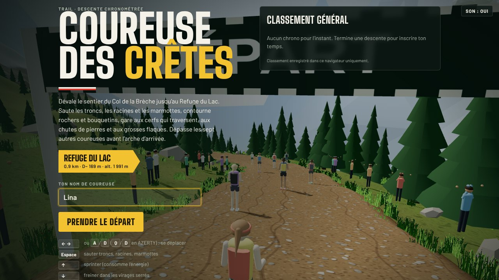
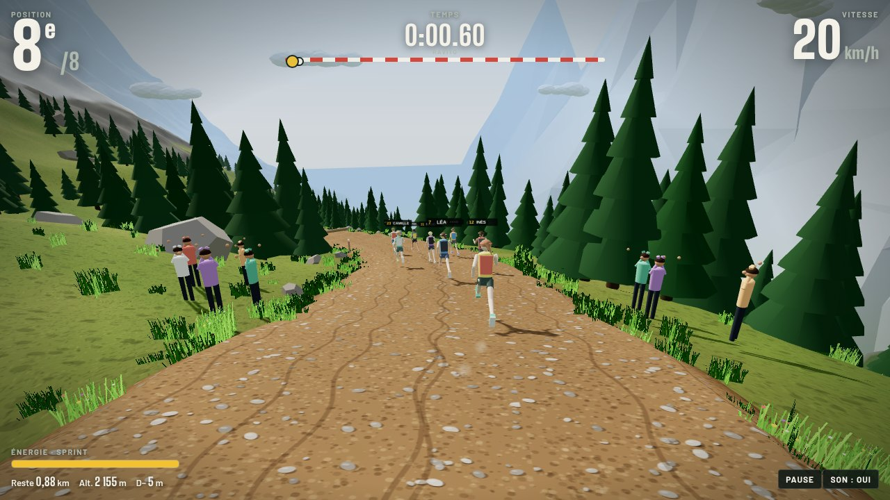
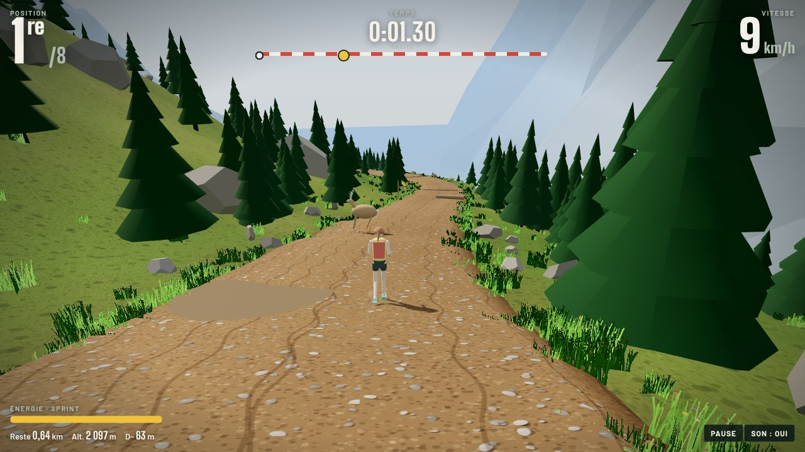
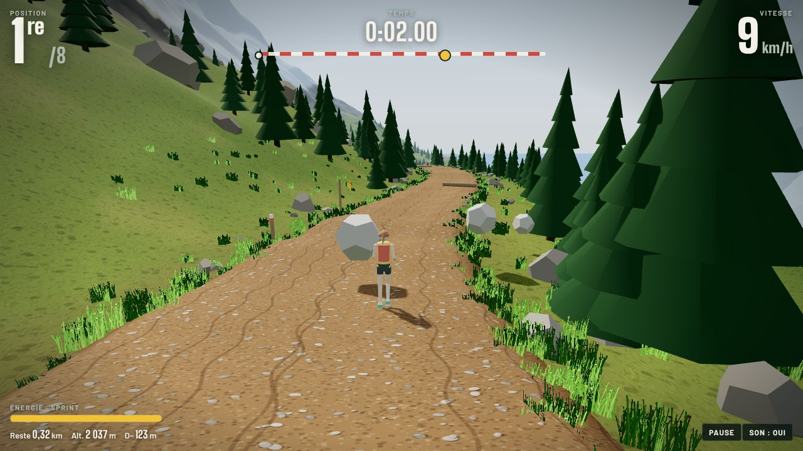
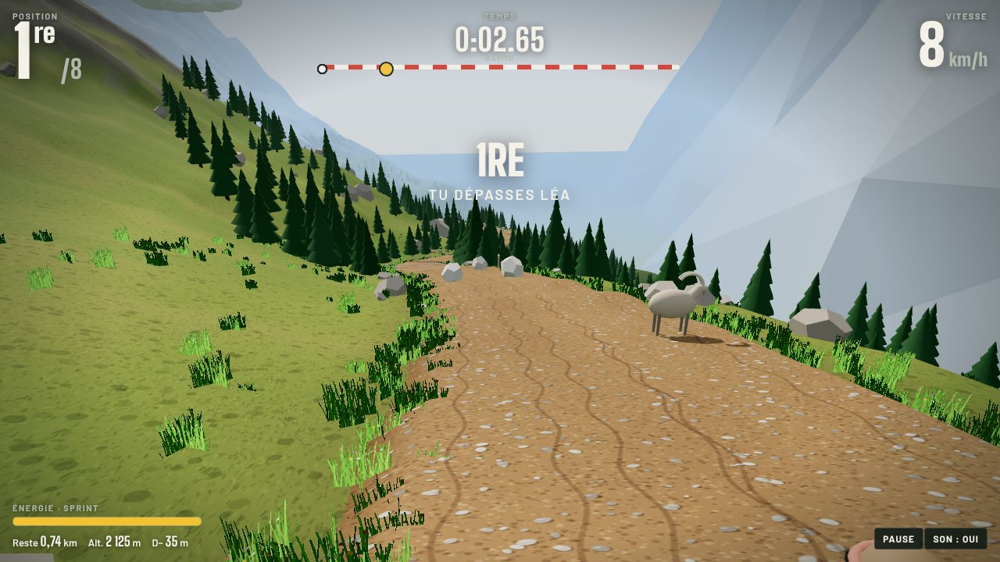
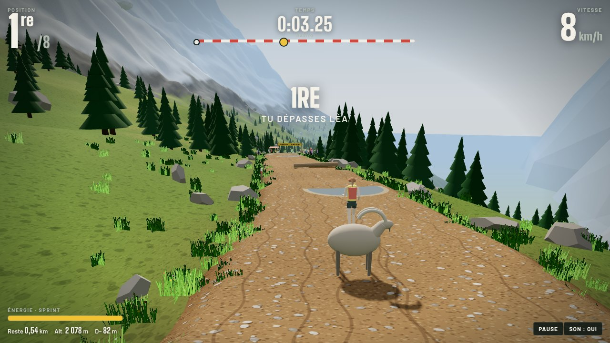

<div align="center">

# 🏔️ Coureuse des Crêtes

**Un jeu 3D de descente en trail, dans le navigateur.**
Dévale le sentier du Col de la Brèche jusqu’au Refuge du Lac, esquive la faune et les pièges de la montagne, et dépasse les sept autres coureuses avant l’arche d’arrivée.




</div>

---

## 🎮 Le jeu

| | |
|---|---|
| **Parcours** | 900 m de single en balcon, environ 170 m de dénivelé négatif |
| **Durée d’une course** | environ 3 minutes |
| **Concurrentes** | 7 coureuses, chacune avec son niveau et son style |
| **Vitesse** | 14 à 20 km/h selon la pente, 23 km/h en sprint |
| **Ravito** | à mi-parcours, avec des bouteilles qui remplissent l’énergie |



Tu pars dernière. La position, le chrono, la vitesse, l’altitude et le dénivelé s’affichent en direct, avec une barre de progression façon balisage GR qui montre où se trouve chaque coureuse.

---

## ⚠️ Les dangers de la montagne

<table>
<tr>
<td width="50%"></td>
<td width="50%"></td>
</tr>
<tr>
<td><b>🦌 Cerf</b> : il attend en lisière puis traverse au galop pile quand tu arrives. Freine, sprinte ou change de côté.</td>
<td><b>🪨 Chute de pierres</b> : annoncée par un panneau triangulaire. Les blocs dévalent la pente en rebondissant, et tu peux parfois passer dessous.</td>
</tr>
<tr>
<td width="50%"></td>
<td width="50%"></td>
</tr>
<tr>
<td><b>🐐 Bouquetin</b> : certains bondissent vers la montagne en te coupant la route, d’autres ne bougent pas. Contourne-les.</td>
<td><b>💧 Grosse flaque</b> : elle ralentit, fait glisser et éclabousse. Mieux vaut la contourner.</td>
</tr>
</table>

Et aussi :

- 🐿️ **Marmottes** : elles sifflent, sortent du terrier et traversent en courant. Saute-les !
- 🪵 **Troncs couchés et racines** : à sauter avec Espace.
- 🪨 **Rochers** : impossible de passer dessus, il faut les contourner.
- 🟤 **Boue et pierriers** : ils ralentissent et font déraper.
- 🌀 **Virages** : pris trop vite, ils te déportent vers l’extérieur. Côté ravin, c’est la chute.

Les concurrentes réagissent aux mêmes dangers et se font parfois avoir, elles aussi.

---

## 🏁 L’arrivée et le classement


À l’arrivée, tu vois ta place, ton temps, ton nombre de chutes et le résultat de la course. Ton meilleur temps entre au **classement général** :

- **sur claude.ai** (version publiée en artifact), le classement est partagé entre tous les joueurs ;
- **ailleurs** (GitHub Pages, en local), il est enregistré dans ton navigateur.

---

## ⌨️ Commandes

| Clavier | Action |
| --- | --- |
| <kbd>←</kbd> <kbd>→</kbd> ou <kbd>A</kbd>/<kbd>D</kbd> (<kbd>Q</kbd>/<kbd>D</kbd> en AZERTY) | se déplacer sur le sentier |
| <kbd>Espace</kbd> | sauter (troncs, racines, marmottes) |
| <kbd>↑</kbd> | sprinter (consomme l’énergie) |
| <kbd>↓</kbd> | freiner avant un virage serré |
| <kbd>Échap</kbd> | pause |

📱 Sur téléphone et tablette, des boutons tactiles apparaissent : ← →, Frein, Sprint, Saut.

---

## 🚀 Lancer le jeu

Le jeu tient dans un seul fichier, `index.html`. La musique se charge à côté, il faut donc passer par un petit serveur local :

```sh
git clone https://github.com/emencia75/coureuse-des-cretes.git
cd coureuse-des-cretes
python3 -m http.server 8000
# puis ouvre http://localhost:8000
```

### En ligne avec GitHub Pages

**Settings → Pages →** source « Deploy from a branch », branche `main`, dossier `/ (root)`.
Le jeu est alors accessible sur `https://emencia75.github.io/coureuse-des-cretes/`.

---

## 🛠️ Sous le capot

- **Three.js r128**, chargé depuis cdnjs. Tout le reste est dans `index.html`, sans étape de build.
- **Monde procédural** : tracé du sentier en sinusoïdes, relief calculé à partir de la distance au sentier, avec épaulement doux côté montagne et vallée côté ravin.
- **Textures générées en canvas** : terre et cailloux du sentier, détail d’herbe, panneaux, dossards.
- **Végétation instanciée** : environ 2 600 sapins et 9 000 touffes d’herbe et de fleurs.
- **IA des concurrentes** : choix de couloir selon les obstacles à venir, sauts, sprints et erreurs aléatoires.
- **Sons synthétisés** en Web Audio (pas, sifflet de marmotte, grondement, éclaboussures), plus la musique de fond.

```
coureuse-des-cretes/
├── index.html            # le jeu complet
├── run-the-ridge.mp3     # musique de fond « Run the Ridge »
└── docs/screenshots/     # captures du README
```

---

## 📄 Licence

Code sous licence [MIT](LICENSE). La musique « Run the Ridge » est fournie par l’auteur du projet.
